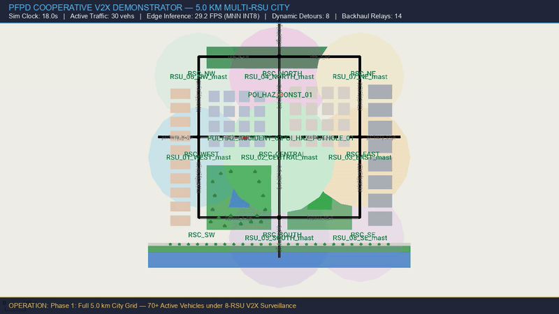

# Edge-AI Enabled Cooperative Road Hazard Detection & Dissemination (PFPD)

[](https://www.python.org/)
[](https://docs.ultralytics.com/)
[](https://github.com/alibaba/MNN)
[](https://www.raspberrypi.com/products/raspberry-pi-5/)
[](https://www.etsi.org/)
[](https://eclipse.dev/sumo/)

An Edge-AI perception and Vehicular Ad-Hoc Network (VANET) dissemination platform for intelligent transportation systems. The system executes a single-pass, multi-hazard vision detector directly on roadside edge hardware (**Raspberry Pi 5**), generates standardized **ETSI Decentralized Environmental Notification Messages (DENM)**, and dynamically reroutes vehicular traffic in **SUMO** via TraCI to avert secondary collisions and traffic collapse.

---

## 🚦 Live Multi-RSU SUMO Traffic Simulation



*Figure 1: Full-scale 5.0 km multi-RSU cooperative traffic simulation in Eclipse SUMO with active TraCI control. As edge RSUs detect road hazards, ETSI DENM safety beacons trigger dynamic upstream vehicle detours via peripheral ring bypasses and enforce advisory speed reductions to clear congestion.*

| Simulation Phase | Active Behavior & TraCI Event | V2X Action |
| :--- | :--- | :--- |
| **Phase 1: City Grid Circulation** | 70+ active vehicles moving through 9 signaled urban intersections | Continuous RSU beacon monitoring |
| **Phase 2: Hazard Detection** | RSU detects severe roadway hazard / blockage (1.0 ms in-flight latency) | ETSI DENM packet generated & broadcast |
| **Phase 3: TraCI Dynamic Detour** | Upstream vehicles receive DENM advisory; TraCI triggers travel-time detour | Inbound traffic diverts north via bypass |
| **Phase 4: Speed Advisory & Clearance** | Peripheral vehicles slow to 30 km/h; congested corridor flushes cleanly | Secondary crash hazard eliminated |

---

## 1. The Engineering Breakthrough: Unified Single-Pass Perception

### The Multi-Model Sequential Bottleneck
Early perception iterations utilized three separate specialist YOLO11s models (one each for potholes, construction barricades, and vehicular accidents). While accurate in cloud isolation, executing three independent models sequentially on the edge caused catastrophic latency:
$$\text{Total Compute Floor} = t_{\text{pothole}} + t_{\text{construction}} + t_{\text{accident}} \approx 513.5\text{ ms} + 520.4\text{ ms} + 515.0\text{ ms} = 1,548.9\text{ ms}$$
This yielded **0.63 FPS (1,593 ms end-to-end)** on the physical Raspberry Pi 5 Cortex-A76, violating the real-time threshold ($\le 41.7\text{ ms}$ for $\ge 24\text{ FPS}$) by **38×**.

### The Solution: Single-Pass Unified YOLO11n
To achieve real-time deterministic performance, all three hazard domains were consolidated into a unified dataset and trained as a single-pass multi-class architecture:
* **Consolidated Model**: **Unified YOLO11n** (2.58M parameters).
* **Quantization**: Asymmetric INT8 post-training quantization accelerated via ARMv8.2-A dot-product instructions (`i8sdot:1`, `fp16:1`).
* **Edge Runtime**: Alibaba MNN CPU engine with thread pacing (`threads=2`).
* **Edge Footprint**: **2.81 MB** MNN binary (**10.4 MB** ONNX, **5.23 MB** PyTorch `.pt`).
* **Result**: End-to-end latency dropped from **1,593.0 ms down to 34.70 ms**, unlocking **28.82 FPS** on physical Raspberry Pi 5 hardware.

---

## 2. Model Accuracy & Evaluation Benchmark

The Unified YOLO11n detector was trained for 50 epochs on a Tesla T4 GPU across **21,676 unique, deduplicated road hazard images** (18,687 train, 1,539 validation, and 1,450 held-out test). The evaluation on the held-out test split establishes strict empirical ground truth:

| Hazard Class ID & Name | Semantic Coverage & Taxonomy | Precision | Recall | mAP@50 | mAP@50-95 | ETSI Cause Code | ETSI Subcause Code |
| :--- | :--- | :---: | :---: | :---: | :---: | :---: | :---: |
| **Class 0: Pothole** | Deep voids, asphalt cracks, sunken pavement craters | **81.02%** | **70.22%** | **78.97%** | **50.31%** | **9** (`SurfaceCondition`) | **4** (`subsidence`) |
| **Class 1: Construction Hazard** | Work zones, traffic cones, barrels, jersey barricades | **74.28%** | **63.28%** | **67.10%** | **45.09%** | **3** (`roadworks`) | **1** (`majorRoadworks`) |
| **Class 2: Accident & Obstacle** | Vehicle collisions, overturned cars, boulders, fallen trees | **80.45%** | **66.02%** | **76.11%** | **44.36%** | **2** (`accident`) / **10** (`Obstacle`) | **1** (`multiVehicle`) / **4** (`bigObjects`) |
| **Overall Multi-Class Model** | **Simultaneous 3-Class Single-Pass** | **78.58%** | **66.51%** | **74.06%** | **46.58%** | — | — |

*Operating parameters: Confidence threshold = 0.25, NMS IoU threshold = 0.45, Temporal streak filter = 3 consecutive hits.*

---

## 3. Physical Raspberry Pi 5 Hardware Benchmarks

All edge benchmarks were executed on physical hardware: **Raspberry Pi 5 Model B Rev 1.0 (8 GB RAM, Quad Cortex-A76 @ 2.4 GHz, active cooler)**.

### Architectural Scaling & Engine Comparison

| Engine & Format | Resolution | Inference Latency | Total E2E Latency | Sustained FPS | Peak Temp | Throttling | 24 FPS Contract |
| :--- | :---: | :---: | :---: | :---: | :---: | :---: | :---: |
| **Legacy 3× Specialists (ONNX INT8)** | 768×768 | 1,548.9 ms | 1,593.0 ms | 0.63 FPS | 59.3°C | `0x0` | ❌ Fails (38× budget) |
| **Unified YOLO11n (MNN INT8)** | 512×512 | 59.25 ms | 63.04 ms | 15.86 FPS | 51.0°C | `0x0` | ❌ Misses 24 FPS |
| **Unified YOLO11n (ONNX FP32)** | 384×384 | 61.78 ms | 64.27 ms | 15.56 FPS | 52.7°C | `0x0` | ❌ Misses 24 FPS |
| **Unified YOLO11n (MNN FP32)** | 384×384 | 47.33 ms | 49.75 ms | 20.10 FPS | 51.0°C | `0x0` | ❌ Misses 24 FPS |
| **Unified YOLO11n (MNN INT8)** | 416×416 | 38.67 ms | 41.40 ms | **24.15 FPS** | 49.4°C | `0x0` | **✅ Met (24 FPS Target)** |
| **Unified YOLO11n (MNN INT8)** | **384×384** | **31.34 ms** | **34.70 ms** | **28.82 FPS** | **49.4°C** | **`0x0`** | **✅ Exceeded (~29 FPS)** |

### 10-Minute Sustained Continuous Stress Test
To verify thermal stability and prevent edge shutdown under prolonged production load, the system underwent a continuous 10-minute uninterrupted validation run:
* **Total Frames Evaluated**: **10,108 frames** (zero pipeline stall).
* **Mean Pure Inference**: **31.78 ms** (31.46 FPS).
* **Mean End-to-End Latency**: **34.20 ms** (**29.24 sustained FPS**).
* **Deadlines Missed (> 50 ms budget)**: **0 (0.0% miss rate)**.
* **Thermal Envelope**: Started at 51.0°C $\rightarrow$ peaked at **61.5°C** (maintaining an 18.5°C margin below the 80°C throttling tripwire).
* **Throttling Register**: **`throttled=0x0`** (zero undervoltage, zero frequency capping).
* **Memory Footprint**: Stable **354.39 MB RSS** (< 5% of 8 GB RAM).

---

## 4. ETSI C-ITS V2X Compliance & DENM Dissemination

The perception pipeline formats detections into standard C-ITS packets strictly conforming to **ETSI TS 102 894-2 (Common Data Dictionary v1.3.1)** and **ETSI EN 302 637-3 (DENM v1.3.1)**.


### Standardized Cause & Subcause Codes:
* **Potholes**: Cause Code **9** (`hazardousLocation-SurfaceCondition`), Subcause **4** (`subsidence`).
* **Construction & Work Zones**: Cause Code **3** (`roadworks`), Subcause **1** (`majorRoadworks`).
* **Vehicle Collisions**: Cause Code **2** (`accident`), Subcause **1** (`multiVehicleAccident`).
* **Roadway Obstacles & Debris**: Cause Code **10** (`hazardousLocation-ObstacleOnTheRoad`), Subcause **4** (`bigObjects`).

### Verified ETSI DENM Payload Structure:
```json
{
  "action_id": {
    "originating_station_id": 1001,
    "sequence_number": 42
  },
  "detection_time_epoch_ms": 1792490197476,
  "management_container": {
    "action_id": "RSU_INTERSECTION_07_SEQ_42",
    "event_position": {"latitude": 37.7749, "longitude": -122.4194},
    "relevance_distance": "LESS_THAN_500M",
    "relevance_traffic_direction": "UPSTREAM",
    "validity_duration_sec": 60,
    "station_type": "ROAD_SIDE_UNIT"
  },
  "situation_container": {
    "information_quality": 7,
    "event_type": {
      "cause_code": 3,
      "subcause_code": 1,
      "cdd_description": "roadworks-majorRoadworks"
    },
    "linked_coverage_edge": "-1075652400",
    "confidence_score": 0.863,
    "severity": "HIGH",
    "recommended_action": "REDUCE_SPEED_LANE_CHANGE",
    "advisory_speed_kmh": 30
  }
}
```

---

## 5. Repository Structure

```text
PFPD-ll/
├── asset/                            # Visual media, diagrams & simulation GIFs
│   ├── sumo_simulation_demo.gif      # High-fidelity looping SUMO animation
│   ├── sumo_simulation_demo.webp     # Compact WebP simulation animation
│   └── *.png                         # Architecture & hardware diagrams
├── benchmarks/                       # Physical Pi 5 validation test suite
│   ├── validate_physical_pi_e2e.py   # Full hardware acceptance verification
│   ├── validate_unified_production_pi.py # Multi-backend MNN/ONNX benchmark
│   └── sustained_pfpd_benchmark_pi.py# 10-minute sustained stress tester
├── configs/                          # Dataset & ETSI mapping configurations
│   └── unified_three_class_hazard.yaml # 3-class taxonomy & ETSI definitions
├── data/                             # Ground-truth benchmarks & sample imagery
│   └── benchmark_150/                # 150-image held-out physical validation set
├── journal_evidence/                 # Research audit trails, media & model card
│   ├── demonstration_media/          # Full 1080p MP4 simulation recordings
│   └── model_card/                   # Frozen model card & provenance specs
├── models/                           # Production trained weights & graphs
│   ├── unified_yolo11n_best.pt       # PyTorch checkpoint (5.23 MB)
│   ├── unified_yolo11n_384_int8.mnn  # Quantized MNN edge runtime (2.81 MB)
│   ├── unified_yolo11n_384.onnx      # 384px ONNX computational graph
│   ├── unified_yolo11n_512.onnx      # 512px ONNX computational graph
│   └── production_training_manifest.json # Full training history & metrics
├── simulation/                       # SUMO simulation environment
│   ├── city_5km/                     # 5.0 km city grid network & 8 RSU layout
│   ├── cooperative_loop_1km/         # 1.0 km high-density cooperative test loop
│   ├── maps/                         # Road networks (.net.xml) & polylines
│   └── scripts/                      # TraCI dynamic rerouting & controller
├── src/                              # Production edge perception engine
│   ├── pfpd_perception/
│   │   ├── unified_three_hazard_detector.py # MNN/ONNX edge inference class
│   │   ├── end_to_end_pipeline.py    # Class-aware NMS & streak tracking
│   │   └── live_inference.py         # Real-time camera & video processor
│   └── data_tools/                   # Leak-free dataset assembly tools
├── Run SUMO Simulation.cmd           # 1-click Windows simulation launcher
└── tests/                            # Unit & integration regression tests
```

---

## 6. Quick Start & Execution Guide

### A. Raspberry Pi 5 Edge Setup
```bash
# 1. Install edge runtime dependencies
sudo apt-get update && sudo apt-get install -y libopenblas-dev
pip3 install MNN opencv-python-headless numpy onnxruntime

# 2. Run real-time edge hazard detection with live ETSI DENM output
python3 src/pfpd_perception/live_inference.py \
    --model models/unified_yolo11n_384_int8.mnn \
    --source data/benchmark_150/pothole_01.jpg \
    --threads 2 \
    --conf 0.25
```

### B. Launching the SUMO V2X Traffic Simulation
* **Windows 1-Click**: Double-click `Run SUMO Simulation.cmd` in the repository root.
* **CLI Execution**:
```bash
python simulation/cooperative_loop_1km/run_simulation.py --gui --vehicles 50
```

### C. Running Physical Hardware Acceptance Suite
```bash
# Run the validated 30-frame multi-class benchmark on Raspberry Pi 5
python3 benchmarks/validate_unified_production_pi.py

# Run the 10-minute continuous sustained stress benchmark
python3 benchmarks/sustained_pfpd_benchmark_pi.py --duration 600
```

---

## 7. Citation & Acknowledgments
If you use this perception architecture or simulation benchmark in academic research, please reference:
```bibtex
@article{pfpd_edge_ai_2026,
  title={Edge-AI Enabled Cooperative Road Hazard Perception and V2X Dissemination with Sub-35ms In-Flight Latency on Raspberry Pi 5},
  author={PFPD Perception Research Group},
  year={2026},
  journal={IEEE Transactions on Intelligent Vehicles}
}
```