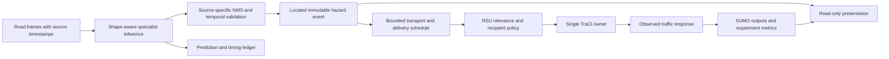

# PFPD: real-model SUMO implementation plan

Date: **14 October 2026, Asia/Calcutta**. Status: **research complete; design proposed; implementation requires user approval**.

Workspace: `C:\Users\adars\OneDrive\Desktop\PFPD-ll`  
Audited base: `main` at `34dad0a3d8683ebb9db548eb105604d8e29cb355`.

## 1. Intended outcome and first gate

Build a traceable **real road image/video → ONNX prediction → temporal validation → located event → emulated RSU warning → TraCI → observed vehicle response → measured experiment**. Preserve the original 1 km corridor and all trained artifacts. A predefined physical scenario or manually mapped location is permitted; a predefined detection presented as a neural prediction is not.

**First implementation milestone, M1:** repair and verify real single-model image inference for each existing specialist, including model identity, preprocessing, decoding/NMS, truthful performance and failure reporting, and temporal-filter unit tests. Do not connect SUMO, change XML, add a dashboard, convert models or retrain in M1. Missing representative positives are a declared blocker to positive-perception acceptance, not permission to fabricate detections. A successful process exit alone is insufficient.

## 2. Repository audit: reuse and remediation

| Component | Verified state | Proposed treatment after approval |
|---|---|---|
| `quantization/*.onnx` | Three executable, distinct static 768-input graphs | Read-only, hash-pinned source of truth; never re-export/overwrite implicitly |
| `src/edge_rpi_hazard_inference.py` | Useful letterbox/NMS/IoU tracker functions; broken default/NumPy/semantic mapping; `--image` is parsed but never executed | Targeted CLI repair and extraction of shared inference primitives |
| `src/benchmark_rpi_multimodal.py` | Shape-derived session benchmarking exists; import-time mkdir, misleading Pi labels, raw proposal counts and invented accuracy fields | Reuse session/timing concepts; fix reporting only within approved scope |
| `simulation/scripts/rsu_hazard_disseminator.py` | Has a real image forward path with model-specific hazard labels; missing default paths, 640 input and fabricated mock fallback; OSM target | Adapt to shared inference/event library; require explicit mock mode and connection state; do not copy its silent fallback |
| `simulation/corridor_1km/corridor.*` | Working network, routes, environment and saved view; continuous demand | Preserve original files; point new integration at them and use separately named scenario/config overlays |
| `run_cooperative_v2x_sim.py` | Scripted detection/control, in-process dictionary, colors and CSV | Preserve legacy demonstration; add a new explicit real-event launcher/controller using reusable control concepts |
| `build_corridor.py` | Older templates overwrite deployed scene/flows/config | Do not run; generator reconciliation is separately scoped future work |
| `run_gui.bat` | Uses `uv run --python 3.11`; interpreter/package resolution differs from explicit `.venv` | Preserve; add a separately named verified launcher later |
| Berhampur OSM | Active `map.sumocfg` loads `maps/map_16_9.net.xml` with different traffic types/closures | Preserve; optional route-validation/rerouting phase after corridor success |
| Existing logs/results | Historical telemetry and benchmark data, no paired safety experiment | Retain as historical records; do not overwrite or relabel as current verified evidence |

### Specific source defects

- Edge runner imports at lines 15–29 omit NumPy; calling preprocessing reproduces `NameError`. Default at 269 points to a missing model; current error path prints a warning and exits 0. `--image` at 270 is unused in `main` (267–338).
- Static graphs require 768×768. A 640×640 input raises ORT `INVALID_ARGUMENT`, rather than merely degrading small-object accuracy.
- Global classes at 31–35 and output handling at 176–204 label every specialist class 0 as pothole. Preserve raw class 0 but resolve domain through trusted source-model identity.
- Existing tracker counts accumulated hits across misses, can emit stale confirmed tracks, and has no actual frame/time inputs. Its “consecutive frames” description is stronger than its implementation.
- Benchmark line 290 computes supposed INT8 precision as `gpu_baseline['precision'] * 0.995`; recall/mAP are reused constants. Remove these from empirical results; there is no accuracy measurement.
- Corridor lines 185–209 use distance-triggered detections and fixed confidence/latency. Warnings occur only inside the 50–60 m same-lane branch. No implemented JSON radio transport, 250 m reach or equipped-vehicle filtering exists.
- Corridor success predicate (212–215) can mark a vehicle green up to 30 m upstream. Telemetry (218–222) divides one-second speed differences by 0.1; use actual acceleration/time instead.
- Advertised 300 s validity never expires events. IDs based on wall-time milliseconds and permanent hazard class keys are inadequate for updates and repeated hazards.

These are code findings, not changes made during research. The local guide PDF is **five pages**, and already qualifies several claims that the master memory overstates. Earlier YOLO11n `.pt`/ONNX artifacts exist under `model_training`; they are not authenticated FP32 counterparts of the deployed YOLO11s suite.

## 3. Verified model contract and measurements

### Artifact identity

| Domain / metadata class 0 | Relative artifact | Bytes | SHA-256 |
|---|---|---:|---|
| `pothole` | `quantization/pothole_yolo11s_int8.onnx` | 9,940,821 | `289c7d60b8d920ef1da65681629c8fc854ccaf7b01474afc5997ba89b1ca077d` |
| `construction_hazard` | `quantization/construction_yolo11s_int8.onnx` | 9,940,838 | `4144423ff28f6fab297828be7965a8104600359fbd2ed58b0da45e16fa7788f8` |
| `road_accident_obstacle` | `quantization/accident_obstacle_yolo11s_int8.onnx` | 9,940,846 | `dc2985e915d44ff419d205bcae0df9fc1cfdf89960e794730b3afcb2134b96bf` |

Shared actual contract: input **`images`**, float32 `[1,3,768,768]`; output **`output0`**, float32 `[1,5,12096]`; IR 7, opset 12. Metadata: Ultralytics 8.4.175, `detect`, `Detect`, stride 32, `end2end=False`, fixed dimensions. Each graph has 839 nodes, including 88 `ConvInteger`, 80 `DynamicQuantizeLinear` and two floating-point `MatMul` nodes. Float interfaces do not imply an FP32-only internal graph.

All pairs have different substantial INT8 weight payloads: 261 of 455 initializer serializations differ, including all 87 substantial INT8 weight arrays. Near-identical file sizes are therefore not renamed duplicate weights. Metadata and weight differences establish identity, not training quality.

Formal `onnx.checker` was unavailable because `onnx` is absent. Graph-field inspection and ORT execution succeeded. Do not describe that as a formal ONNX checker pass.

### Preprocessing and decoding requirements

Read dimensions from the session and assert the reviewed contract. Keep batch 1. Letterbox using aspect-preserving resize and 114 padding, convert BGR to RGB, normalize float32 by 255, transpose to CHW and ensure a contiguous `[1,3,H,W]` array. Record actual scale and integer padding. Do not force a resolution merely because training used it.

Decode output as center x/y, width/height in network-input pixels and one class score; there is no extra objectness score in this five-channel export. Convert to float xyxy, filter confidence, perform per-source single-class NMS, invert letterbox, clip and only then round. NMS within one source model does not merge unrelated domains. Validate finite coordinates, nonempty area and bounds. Current early integer rounding has small avoidable errors.

Use a reviewed manifest mapping exact file/hash and class 0 to its semantic name. Cross-check metadata; safely parse names (no `eval`). Unknown artifacts or semantic conflicts fail clearly. A confidence score is not measured precision, severity, distance or accident subtype. Start with **confidence 0.35, NMS IoU 0.45** as provisional compatibility values, then freeze per-model thresholds using labeled validation. No >95% calibration claim is authorized. [Ultralytics scaling](https://docs.ultralytics.com/reference/utils/ops/), [NMS reference](https://docs.ultralytics.com/reference/utils/nms/).

### Live audit measurements: desktop scope only

Host: Ryzen 5 5500U, Windows AMD64, Python 3.11.16, ORT 1.31.0 CPU provider; all sessions resident, sequential ORT execution, four intra-op / one inter-op thread per model, graph optimizations enabled. Input was the real sample tensor. Two warmups and five timed passes per model:

| Model | Mean ms | P50 ms | P95 ms | Inference-only passes/s |
|---|---:|---:|---:|---:|
| Pothole | 4,134.52 | 3,992.82 | 5,380.38 | 0.242 |
| Construction | 3,825.19 | 3,746.44 | 4,151.36 | 0.261 |
| Accident/obstacle | 5,411.29 | 4,687.68 | 7,724.67 | 0.185 |

A persistent three-worker pool, one warmup and three timed triplets: **7,797.15 ms mean**, P50 7,144.55, P95 9,189.06, **0.128 three-model frames/s**. These do not include decode, preprocessing, NMS, tracking, transport or vehicle response. Samples are small and workstation activity adds noise; percentiles are descriptive smoke results. Do not infer a particular kernel bottleneck without profiling.

Process RSS was 57.40 MiB after imports, 120.78 MiB after loading all models, 367.38 MiB after triplets and 370.44 MiB at the final image probe. These are snapshots, not a peak-memory trace. The historical comparison JSON already reports about 2.9–3.0 s/model; it does not authenticate Raspberry Pi performance. Concurrent session residency and concurrent execution are different. [ORT thread tuning](https://onnxruntime.ai/docs/performance/tune-performance/threading.html).

### Real-image behavior and missing fixtures

All six model/image passes on two local original images produced finite outputs. At confidence 0.35 / NMS 0.45:

| Image | Pothole boxes | Construction boxes | Accident/obstacle boxes |
|---|---:|---:|---:|
| `data/sample_pothole_verified.jpg` | 2 | 0 | 2 |
| `data/sample_pothole_prominent.jpg` | 0 | 1 | 0 |

The first image's pothole boxes `[243,104,281,134]` (0.602654) and `[132,115,170,151]` (0.522600) lie in upper foliage, not an obvious road pothole. Both images are unannotated ordinary dashcam scenes; names do not establish ground truth. These are execution/decoding smoke inputs, not successful positive-perception validation.

Input SHA-256: verified `82295120062988eb4e8389eba8a1b0d84d95996462cb92586ff872efc9fa2e2a`; prominent `a0fe079380c48fd6779c3b8f80fa4d7e1a69b36d578d9f49c9d91270214d89b3`.

Require a small reviewed set of labeled positives and clean negatives for each domain, and distinct real frames for temporal validation. No construction/accident positive footage or videos were found. Full test-set precision/recall/mAP and matched FP32-versus-INT8 accuracy remain separate work; no training images are to be downloaded wholesale.

## 4. Selected architecture and module boundaries



Proposed files below do **not** exist as a result of this research. Add them incrementally only within approved phases; combine adjacent small modules if that preserves these boundaries without needless scaffolding.

| Proposed boundary / location | Responsibility | Must not do |
|---|---|---|
| `src/pfpd_perception/model_registry.py` | Reviewed paths/hashes/shapes/class semantics/session creation | Implicitly convert/retrain models |
| `src/pfpd_perception/inference.py` | Shared letterbox, runtime invocation and NMS/unletterbox | Fabricate detections on error |
| `src/pfpd_perception/input_adapter.py` | Image/clip decoding, frame IDs/hashes/PTS and optional camera adapter | Claim hardware camera operation from file replay |
| `src/pfpd_perception/temporal.py` | Domain/source-scoped distinct-frame association and confirmation | Reuse class 0 across domains or emit stale confirmation |
| `src/pfpd_perception/events.py` | Validated event DTO, revisions, provenance and mapping | Derive geographic metres from pixel boxes without calibration |
| `simulation/scripts/pfpd_event_transport.py` | Bounded queue and deterministic service/delivery ledger | Call TraCI from an inference worker |
| `simulation/scripts/pfpd_rsu_controller.py` | Coverage, equipment, route relevance, expiry, duplicate suppression | Claim physical packet delivery |
| `simulation/scripts/run_model_driven_corridor.py` | Sole TraCI owner, orchestration, safe response, observed crossing | Replace legacy runner or regenerate network |
| `simulation/scripts/pfpd_telemetry.py` | Append-only run evidence, clocks, commands/outcomes and metrics | Invent unavailable accuracy fields |
| `simulation/scripts/pfpd_presentation.py` | Optional small frame/telemetry view; GUI overlay adapter | Own simulation state or silently relabel replay as live |
| `configs/simulation/*.json` | Separate scenarios, fixture mapping, recipients, timing and thresholds | Modify original corridor XML as implicit setup |
| `tests/` | Standard-library `unittest` component/integration checks | Substitute mock-only tests for real model evidence |

### Architecture decisions and trade-offs

- **ADR-01, proposed:** Approach A and preserved corridor. It uses the real models with modest scope; spatial mapping remains explicit and manual initially. Revisit only after causal integration succeeds.
- **ADR-02, proposed:** One TraCI owner and standard-library queue. It reduces synchronization failure points. `queue.Queue` is thread-safe, not cross-process transport. A later multiprocessing adapter must use its own queue and Windows-safe entry point. TCP is the extension for a remote Pi; MQTT/ZeroMQ are deferred until a demonstrated transport need.
- **ADR-03, proposed:** First live integration uses one inference worker and sequential model scheduling; choose one specialist for standalone scenarios, all three for the combined run. Compare thread budgets empirically rather than spawning three four-thread workers by default. Both schedule and enabled models are recorded.
- **ADR-04, proposed:** Pair traffic experiments using one frozen genuine-inference ledger. This isolates advisory effects. A separate online experiment measures actual resource contention and frame-to-warning performance.
- **ADR-05, proposed:** Native SUMO plus lightweight local presentation. A frontend is justified only if presentation evidence shows a usability problem.

## 5. Spatial mapping and clock policy

Initial footage is associated with a **fixed RSU** and a known fixture. It may be recorded elsewhere; disclose that association as `manual_scenario_fixture`. Its bbox is camera pixels, while its event location is a reviewed SUMO edge/lane/longitudinal interval. AI decides whether/when a visual hazard is detected; the fixture mapping supplies the road location. The detector does not estimate GPS.

Authoritative initial positions are construction 250 m, pothole 350 m and accident/obstacle 430 m on `edge_2_0`. Derive drawing positions with `simulation.convert2D`: `(557.2,95.2)`, `(657.2,95.2)`, `(737.2,95.2)`. Fixture extents are proposed experimental values, not sensor-estimated dimensions. Store network/config hashes in every mapping.

Use source presentation timestamps if available. If a clip lacks reliable PTS, derive an explicitly estimated frame timestamp from its verified frame rate; never imply exact capture time. Moving-lead perception later requires a synchronized pose ledger and must not substitute the current vehicle position for an earlier captured frame.

Maintain three clocks: source media time, monotonic process time for durations, and actual SUMO time. Store epoch UTC only for audit identity. Do not subtract values from different clocks. [Clock reference](https://docs.python.org/3.11/library/time.html).

For deterministic real-inference service scheduling:

1. Map capture time with the configured source offset into simulation seconds.
2. For a serial worker, `service_start=max(capture_sim_s, previous_service_finish)`; `service_finish=service_start+measured_full_service_s`.
3. Associate distinct frames in order; confirm only after the required frame's service finishes. No separate additional temporal delay is needed if it is already in the capture/service sequence.
4. Schedule uplink, processing, downlink and configured driver reaction delay after confirmation; apply only on/after the resulting tick.
5. A simulation paused during wall-clock inference remains a slow demonstration; it receives no zero-latency experimental advantage. The optional idealized zero-processing-delay arm must be labeled idealized and excluded from claims about observed hardware.

Replay uses those same scheduled events and recorded durations. Online mode consumes the latest frame with a small bounded queue, records capture/start/finish/delivery wall times, and rejects stale results. It must never backdate control or silently conceal dropped frames.

A **three-hit confirmation** default uses three distinct ordered processed frames, same source/model, IoU ≥0.40 and a configurable maximum capture-time gap. Reset the candidate streak on a missed processed frame; expire tracks by time as well as frame count. Associate greedily only once per detection/track, with deterministic tie-breaking. Report representative confidence conservatively (for example minimum of the confirming hits), plus per-hit scores. Replaying one still three times is a tracker test, not temporal evidence.

## 6. Hazard-event and delivery schema

Use a versioned application JSON schema, **`pfpd.hazard.v1`**, not an ETSI conformance claim. A validated immutable event and separate append-only delivery records keep perception facts separate from recipient state.

| Field group | Required contents and validation |
|---|---|
| Identity | `schema_version`, `run_id`, stable `event_id`, `revision`, `message_kind` (`confirm/update/terminate`); monotonic revision per event |
| Perception provenance | `perception_mode`, source asset/frame hashes and frame IDs, `source_model_id`, model path/hash, `raw_class_id`, `hazard_type`, confidence 0–1, threshold/NMS settings, tracker evidence |
| Source | `source_station_id`, source kind fixed RSU or vehicle, nullable source vehicle ID, RSU ID |
| Time | Source PTS and units, captured UTC if known, capture/confirmation/eligible simulation seconds, actual application tick, stage wall durations, expiry |
| Location | Network hash, edge ID, lane ID/index, lane-position interval in metres, derived x/y in network coordinates, mapping method/reference, nullable uncertainty and geographic coordinates |
| Advisory | Desired speed in km/h and m/s, maneuver preference, severity rationale independent of score, affected lanes, clearance condition |
| Dissemination policy | RSU coverage radius, approach horizon, equipment/relevance policy ID, repetition/loss/delay seed/config, initial status |
| Standards note | `format='DENM-inspired application JSON'`, nullable pinned cause/subcause; no fabricated geolocation, actionID, station encoding or interoperability assertion |

Illustrative event below defines the proposed wire contract; its numbers are **not measured detections**:

```json
{
  "schema_version": "pfpd.hazard.v1",
  "run_id": "example-run",
  "event_id": "example-rsu1-pothole-track7",
  "revision": 1,
  "message_kind": "confirm",
  "perception_mode": "real_onnx",
  "source_model_id": "pothole",
  "model": {"path": "quantization/pothole_yolo11s_int8.onnx", "sha256": "289c7d60b8d920ef1da65681629c8fc854ccaf7b01474afc5997ba89b1ca077d"},
  "raw_class_id": 0,
  "hazard_type": "pothole",
  "confidence": 0.7,
  "thresholds": {"confidence": 0.35, "nms_iou": 0.45},
  "source": {"station_id": "RSU_ZONE_01", "kind": "fixed_rsu", "vehicle_id": null, "asset_id": "reviewed-pothole-clip"},
  "evidence": {"frame_ids": [40, 41, 42], "frame_sha256": ["hash40", "hash41", "hash42"], "bbox_xyxy_px": [100, 200, 180, 260], "persistence_hits": 3},
  "time": {"source_pts_s": 4.2, "captured_utc": null, "capture_sim_s": 44.2, "confirmed_sim_s": 48.2, "eligible_sim_s": 48.3, "applied_sim_s": null, "service_wall_ms": 4000.0, "expires_sim_s": 344.2},
  "location": {"network_sha256": "reviewed-network-hash", "edge_id": "edge_2", "lane_id": "edge_2_0", "lane_index": 0, "start_lane_pos_m": 350.0, "end_lane_pos_m": 356.0, "x_m": 657.2, "y_m": 95.2, "mapping_method": "manual_scenario_fixture", "mapping_ref": "pothole-scenario", "uncertainty_m": null, "latitude": null, "longitude": null},
  "advisory": {"speed_kmh": 25.0, "speed_mps": 6.944444, "maneuver_preference": "slow_or_safe_merge", "severity": "scenario_defined", "clearance": "rear_bumper_past_end"},
  "dissemination": {"rsu_id": "RSU_ZONE_01", "coverage_radius_m": 300.0, "approach_horizon_m": 250.0, "recipient_policy_id": "equipped_forward_route_v1", "status": "queued"},
  "standards": {"format": "DENM-inspired application JSON", "cdd_version": "1.3.1", "cause_code": 9, "subcause_code": 0}
}
```

Validate expiry after capture, confidence bounds, monotonic revisions, known models/modes, valid lane/extent, finite values and eligible time ≥ confirmation. Never use placeholder hashes in an actual run. A producer need not know `applied_sim_s`; application adds an immutable receipt record rather than mutating the original prediction.

Delivery record: `run_id/event_id/revision/recipient_id/message_sequence`, send/due/received time, age, route distance, coverage distance, delivery status (`delivered/dropped/stale/irrelevant/expired/duplicate`), and response status (`none/pending/blocked/started/completed/cleared`). An application receive/ack record is a simulation observation, not a radio ACK.

### Deduplication, expiry and interruption rules

- Stable event identity is scoped by run, station, model and tracked/location-associated hazard. Updates increment revision; repetitions retain revision and carry a delivery sequence. Do not use one permanent ID for every pothole.
- Drop duplicates and older revisions. Buffer future events until eligible; never apply out-of-order controls retroactively. Termination is a tombstone retained until the event's validity window ends so delayed confirmations cannot resurrect it.
- Expiry is anchored to the latest genuine observation, not delivery. A late warning cannot refresh itself. New confirmation evidence may extend validity within scenario policy.
- Bound latest-frame queues and event queues separately. Use finite waits/sentinel cancellation compatible with Python 3.11, not `Queue.shutdown` introduced later. Log overflow as a failed/degraded run; do not silently drop confirmed events.
- A worker failure produces an error/status message, never a default 0.945 detection. Transport interruption stops new knowledge and lets receiver advice expire/clear safely. No network infrastructure is required for the first local mode.

## 7. RSU recipient and safe-response policy

Proposed initial assumptions: RSU marker `(500,83)`; **300 m Euclidean emulated station coverage** and **250 m route approach horizon**. These are distinct configurable assumptions. They are neither implemented today nor measured RF coverage.

Select equipped recipients only. Require the affected edge ahead in the vehicle's remaining route, positive valid `getDrivingDistance`, matching travel direction, coverage and approach distance, active event and timely delivery. Exclude passed, departed, opposite-direction and unrelated cross-street vehicles. Give an unaffected adjacent-lane vehicle information only unless its path/queue is also affected. Log why each candidate was accepted or rejected.

Preserve safety modes, normally speed 31 and lane-change 1621, and record actual modes. Check target lane exists, permits the vehicle class and continues its route. Examine maneuver state/neighbor gaps, issue a finite safe request, then observe lane IDs and gap outputs. `couldChangeLane` is not a future guarantee. Do not force movements inside junctions or to an unavailable lane. [Vehicle-control reference](https://eclipse.dev/sumo/docs/TraCI/Change_Vehicle_State.html).

Compute a comfortable speed-transition duration from current speed, target and configured deceleration, respecting type limits. Never accelerate a vehicle that is already slower merely to reach an advisory. A blocked merge falls back to safe slowing/stopping, logs the rejection and retries only while relevant. Driver compliance/reaction are explicit scenario parameters. Coordinate overlapping events through one action arbiter: choose the most restrictive compatible speed and a valid lane path, not competing commands.

Clear protection only after rear-body passage of the full interval, validated route divergence, or a verified safe transition after termination/expiry. Expiry stops new dissemination; it does not remove a physical fixture, cancel an ongoing safety maneuver, or justify accelerating a still-exposed vehicle. Record stale knowledge and let the native safety model/local observation govern a safe transition, without renewing an expired alert as if fresh evidence arrived. A point ahead of the vehicle does not count as passage. Restore saved per-vehicle control/colors and lane permissions/speed limits when safe and when no other event requires them. Failed safe passage is a measured outcome, not a reason to disable checks.

### DENM terminology and code correction

Pinned research reference: **ETSI TS 102 894-2 V1.3.1 (2018-08)**. It assigns 95 to emergency vehicle approaching, 96 to dangerous curve, and 97 to collision risk. Proposed coarse application mappings are pothole/surface condition **9/0**, roadworks **3/0**, reviewed accident **2/0**, reviewed obstacle **10/0**. The broad accident/obstacle model does not distinguish those causes; keep cause null/unknown until scenario evidence supplies a justified subtype. [Official CDD](https://www.etsi.org/deliver/etsi_ts/102800_102899/10289402/01.03.01_60/ts_10289402v010301p.pdf).

DENM EN 302 637-3 V1.3.1 uses an ASN.1 schema and unaligned PER, with semantics unlike these application dictionaries. A newer CDD exists, so a future conformance project must pin compatible DENM/CDD modules and validate exact encodings. This prototype does not undertake that work. [DENM specification](https://www.etsi.org/deliver/etsi_en/302600_302699/30263703/01.03.01_60/en_30263703v010301p.pdf), [newer CDD V2.3.1](https://www.etsi.org/deliver/etsi_ts/102800_102899/10289402/02.03.01_60/ts_10289402v020301p.pdf).

## 8. Independently testable scenarios

Fixtures below are **proposed experimental geometry**. Physical onset/clearance can be scripted identically in both experiment arms; perception confirmation must come from real predictions. Inputs need reviewed positives/negatives before claims of successful model-triggered behavior.

### S1: pothole / road surface

- Location: `edge_2_0`, interval `[350,356]` m, corresponding start `(657.2,95.2)`.
- Input: genuine pothole clip observed by fixed sensing source; later optional lead camera with a synchronized pose ledger.
- Fixture: lane-region surface exposure and visible patch; do not insert a stopped vehicle and describe it as pothole physics.
- Response: provisional 25 km/h advisory while exposed, safe optional merge; stopping only if policy/traffic makes it appropriate. Unwarned arm retains normal native behavior and the same exposure region.
- Evidence: real source boxes/confirmation, recipients warned upstream, speed at interval entry, affected-lane exposure, braking/merge distance and actual rear-body clearance.
- Failure cases: missed/false detection, late event, crowded lane 1, stale warning and vehicle already beyond interval. No vehicle collision against a drawn pothole is expected.

### S2: construction / workzone

- Location: `edge_2_0`, proposed interval `[235,265]` m around the existing 250 m anchor.
- Input: genuine cones/barricades/workzone clip, construction class 0 mapped correctly.
- Fixture: visible cones plus a stopped work vehicle/blocker representing a local occupancy restriction. Place it before demand or safely within a verified vacant gap; clear it at a predetermined scenario time in both arms.
- Response: provisional 20–25 km/h approach advisory, safe merge to lane 1, safe stop if no merge gap. Record native local responses in baseline.
- A separate administrative-closure test can temporarily change whole `edge_2_0` permissions, with capture/restore and class validation. Label it an approximately 485.6 m closure, and do not use it to claim a local 30 m workzone or isolated warning benefit.
- Evidence: same obstruction in both arms, real detection, executed/blocked merges, gap quality, queues, entry speeds, closure/clearance and restoration.

### S3: accident / unexpected obstacle

- Location: `edge_2_0`, proposed interval `[430,440]` m.
- Input: reviewed accident/debris footage. Preserve broad detector semantics; scenario annotation distinguishes stopped wreck versus debris only when supported.
- Fixture: stopped obstructing vehicle present safely before approaching traffic, with defined onset/clearance. Do not teleport a blocker into occupied traffic to manufacture collisions.
- Response: provisional 20 km/h approach advisory, safe adjacent merge or controlled stop; native baseline traffic still sees the same physical blocker locally.
- Evidence: warning lead time and distance, minimum vehicle-vehicle TTC/headway, braking episodes, response completion, travel delay and before/after flow. Rerouting is unavailable until a bypass is separately verified.

### S4: combined corridor demonstration

Use separate source mappings, distinct event IDs, and independent lifetimes. Initially stage construction, then pothole, then obstacle in non-overlapping active windows; show all locations but focus the presentation on the active event. Let traffic return to a normal state between windows without forcing an unsafe lane return. A later overlapping run tests action arbitration and propagated queues.

An early construction merge can protect a vehicle from later lane-0 hazards without a second response. Log that as prior protection, not three independent avoidance successes. Use standalone S1–S3 for domain-specific conclusions. Equipment penetration, reaction delay and compliance vary through deterministic per-vehicle assignments, applied identically in paired arms. Cars/buses/trucks are already present; motorcycles/autos are optional derivative demand, not silently added to the original.

## 9. Presentation plan

Use three coordinated surfaces: annotated real frame, existing SUMO-GUI, and compact telemetry. Display mode labels (`REAL INFERENCE / SLOW PLAYBACK`, `GENUINE INFERENCE REPLAY`, `MOCK PERCEPTION`) continuously. Frame and telemetry view can use a small standard-library Tkinter/Pillow adapter if available; the installed OpenCV package is headless. Check display availability before choosing an implementation.

Native overlay states should follow actual event/vehicle states: unconfirmed candidates stay in the video; confirmed events gain geometry-derived markers; covered recipients are highlighted; pending/blocked maneuvers remain amber; green requires observed passage. Show assumed station coverage as an outlined polygon with a legend. Pre-existing scene hazard drawings may remain as scenario ground truth, visibly distinct from AI confirmation.

Show source/model hash prefix, confidence, capture/confirmation/eligible/applied times, wall latency, warnings, request/completion counts and selected safety/flow measures. Avoid distracting streams of every vehicle. Saved camera views and deterministic screenshot timing make the faculty sequence reproducible. GUI screenshots/video are presentation evidence, not substitutes for logs. No new web framework is justified until this layout is reviewed. [Native GUI](https://eclipse.dev/sumo/docs/sumo-gui.html).

## 10. Scientific validation protocol

### Experiment arms and reproducibility

For each standalone scenario, compare:

1. **Baseline/local reaction:** identical hazard existence, native SUMO safety behavior and demand; cooperative delivery/action disabled.
2. **Experimental:** same physical scenario and a frozen genuine-inference ledger; recipients receive warnings subject to the declared transport and response policy.

Also include a mock event component-test arm, an optional idealized-latency upper bound, and separate online timing tests. Do not mix their results. Input footage/model/ledger, demand, vehicle assignment, source timing, signal setup, hazard onset/clearance and simulation seed must match in the paired traffic arms. Traffic trajectories may diverge as an outcome; identical seeds do not mean trajectories should remain identical after intervention.

Suggested initial seeds: **42–51**, treated as ten paired run-level samples, with frozen demand/assignments and a drain period after demand stops. These are proposed values, not executed research runs. Predefine metrics and settings before evaluation. Use paired differences and run-level confidence intervals; do not count every step/vehicle as an independent trial. Communication randomness uses a separate seed so it does not alter traffic demand. [Randomness](https://eclipse.dev/sumo/docs/Simulation/Randomness.html).

Run manifests include HEAD/dirty diff, OS/CPU/RAM/provider/thread settings, binary and imported TraCI versions, model/input/config/network/ledger hashes, step size, seeds, source offsets, frame policy, thresholds, confirmation rule, delay/loss/reaction/compliance parameters, collision configuration, demand horizon and unfinished vehicles.

### Measurements

| Measure | Definition / evidence |
|---|---|
| Perception success | Fixture-matched event detections/misses and false alerts against reviewed ground truth; FP32/INT8 comparison only with matched artifacts/splits |
| Latency | Acquisition/preprocess/infer/NMS/confirmation/queue/delivery/reaction measured separately; p50/p95 wall and simulation timing must not be conflated |
| Warning distance | Positive driving distance at actual reception, not detector threshold or Euclidean station distance |
| Pothole exposure | Lane-region entry/count/duration and speed at entry; a declared advisory threshold is a behavior surrogate, not a damage model |
| Time-to-hazard | Route distance divided by positive speed; label distinct from TTC; stopped/no-route values are NA |
| Braking | Native acceleration each tick; prespecified episode threshold such as below −3 m/s², reported as an experimental threshold plus SUMO emergency-stop flags |
| Maneuvers | Requested/blocked/observed lane changes, completion before hazard, target actual/required gaps and rear clearance |
| Surrogate conflicts | TTC/DRAC/PET where defined, headway and threshold exceedances; deduplicate reciprocal encounter logs |
| Collisions | Native collision output with min-gap factor and junction checks pinned; no invented collision with a decorative surface patch |
| Traffic | Completed/unfinished trips, duration, time loss, waiting/departure delay, throughput, queues, teleports and reroutes |
| Resources | Per-stage process RSS/peak sampling, CPU, dropped frames, backlog and real-time factor; physical Pi thermal/throttle data only on actual hardware |

Enable future outputs in distinct run directories: `--collision-output`, `--lanechange-output`, `--tripinfo-output`, `--tripinfo-output.write-unfinished true`, `--fcd-output` and appropriate SSM device settings. Set `--collision.action warn`, declare `--collision.mingap-factor` (for example 0 for physical bumper overlap), and enable junction checking if that is part of the study. Disable routine teleports or count/report every teleport with a bounded gridlock policy. Existing source/config safety settings stay fixed across arms. [Collisions](https://eclipse.dev/sumo/docs/Simulation/Output/Collisions.html), [lane changes](https://eclipse.dev/sumo/docs/Simulation/Output/Lanechange.html), [tripinfo](https://eclipse.dev/sumo/docs/Simulation/Output/TripInfo.html).

SSM outputs support vehicle conflicts, not pothole contact. Start with documented TTC/DRAC/PET definitions and distinguish logging thresholds from universal safety limits. Handle NA, empty output and incomplete encounter coverage explicitly. Lower finite TTC indicates less margin; the old table calling 0.06 s “zero danger” is incorrect. [SSM device](https://eclipse.dev/sumo/docs/Simulation/Output/SSM_Device.html), [FHWA surrogate-safety validation research](https://www.fhwa.dot.gov/publications/research/safety/08051/01.cfm).

If both arms have zero collisions, report **0 versus 0; percentage reduction undefined**. Success can still be earlier warning, lower hazard-entry speed, better braking/merge margins or reduced conflict exposure, with traffic costs disclosed. Adverse effects and null effects are valid results. Do not tune away failures and publish only successful seeds.

## 11. Phase roadmap and evidence gates

All phases below are proposed. Approval of research alone does not execute them; the implementing agent follows the user's explicitly approved milestone scope.

### Phase 0 — preserve and reproduce the audit

- **Objective/dependencies:** verify current checkout and environment before edits; read master memory and this design.
- **Files/changes:** inspect existing source/models/XML; create a dependency/runtime manifest and preserve pre-edit hashes in the future run record. No original scenario/model changes.
- **Tests:** import/version/path checks, model session contract, strict corridor load and traffic-only smoke without overwriting prior outputs.
- **Success/evidence:** documented base/diff, exact interpreter/provider/binary/client versions and model/network hashes.
- **Risks/unchanged:** stale memory, PATH Python and mismatched TraCI; preserve all original artifacts, credentials and historical outputs.

### Phase 1 / M1 — real inference remediation

- **Objective/dependencies:** working image inference for each specialist; existing ORT/NumPy/OpenCV, reviewed images.
- **Files/changes:** targeted edge runner and shared registry/inference module; bounded benchmark reporting fixes, small unittest files, optional small dependency manifest. No SUMO/event transport/GUI changes.
- **Tests:** actual CLI image run, missing model/input/runtime nonzero exits, tensor/normalization/letterbox/NMS/clip tests, domain mapping for class 0, no fabricated fallback, tracker streak/miss/stale tests; inspect predictions on labeled positives/negatives.
- **Success/evidence:** finite real outputs and correct image-space boxes for each artifact; positive/negative fixture evidence reviewed with fixed thresholds; actual host timings reported; model hashes unchanged. Missing positives explicitly block perception acceptance.
- **Risks/unchanged:** questionable predictions, no matched test split or FP32 source; preserve artifacts, samples, original corridor, old benchmark JSON and project memory until a verified milestone is ready.

### Phase 2 — genuine located events

- **Objective/dependencies:** M1 accepted; representative distinct-frame clips and reviewed mapping.
- **Files/changes:** input/temporal/events modules, scenario mapping JSON, immutable prediction/event ledger.
- **Tests:** streak/reset/identity, repeated-still rejection, timestamp ordering, expiry/revisions/termination, no-event path, schema validation and mapping bounds.
- **Success/evidence:** at least one genuine confirmed event with linked frames/hash/model/clock/mapping, plus negative and stale rejection; no mocked record in real mode.
- **Risks/unchanged:** fixture association is manual; preserve original models/network and do not claim geometric localization.

### Phase 3 — first corridor connection

- **Objective/dependencies:** approved event schema and one genuine domain ledger; single TraCI owner.
- **Files/changes:** new model-driven launcher, bounded transport, RSU relevance/controller and telemetry; original corridor loaded as-is with separately named fixtures/configs.
- **Tests:** one event reaches an upstream equipped vehicle; no-event/warnings-off/opposite-route/passed/expired/absent-lane cases; safe blocked-merge fallback; orderly close/restart.
- **Success/evidence:** linked event→delivery→command→observed response; real inference runs during a slow demonstration, with separately repeatable genuine-ledger replay and measured-delay scheduling.
- **Risks/unchanged:** seconds-scale inference and normal native safety responses; original corridor and legacy launcher stay usable.

### Phase 4 — S1/S2/S3 independent validation

- **Objective/dependencies:** Phase 3 accepted and authentic inputs for all domains.
- **Files/changes:** separately named scenario configs/fixtures, physical blocker setup/clearance and targeted validation tests.
- **Tests:** each domain end-to-end, same fixture in paired arms, late/false/missed detection, no merge gap, event termination and restoration.
- **Success/evidence:** three independently reproducible real-perception/control chains with honest limits and failure reports; construction temporary local occupancy/restriction represented physically.
- **Risks/unchanged:** absent clips, broad accident semantics, closure behavior in 1.27.1; no route invention or original network rebuild.

### Phase 5 — combined presentation run

- **Objective/dependencies:** independent scenarios accepted.
- **Files/changes:** combined configuration, event arbitration and staged lifetimes/focus; all three genuine models enabled in this mode.
- **Tests:** sequential windows then overlap, prior-protection attribution, no contradictory commands, cleanup across expiry/restarts.
- **Success/evidence:** coherent three-hazard session and source-linked event/response records; throughput and playback mode visible.
- **Risks/unchanged:** early closure hides later effects; preserve standalone experiments and do not call the combined scene three independent efficacy trials.

### Phase 6 — controlled scientific evaluation

- **Objective/dependencies:** fixed validated configurations, evidence parser and predeclared analysis protocol.
- **Files/changes:** experiment runner/metrics scripts and output-only run directories; ten paired seeds initially, with a fixed ledger and preserved inputs.
- **Tests:** reproducibility, output XML parsing/counts, unfinished-trip accounting, metric units/NA/episode deduplication and run-level comparisons.
- **Success/evidence:** baseline/treatment manifest pairs, complete independent outputs, paired differences/uncertainty, null and adverse outcomes reported.
- **Risks/unchanged:** no baseline collisions, model-domain shift, repeated-observation bias; do not manufacture crashes or rewrite historical results.

### Phase 7 — presentation polish

- **Objective/dependencies:** correct causal loop and reliable telemetry.
- **Files/changes:** native overlays, compact frame/telemetry adapter, separately saved views and screenshots; optional dashboard only after usability justification.
- **Tests:** manual GUI review of frame/time alignment, pending/complete labels, map placement, legibility, slow/replay/mock identity; technical snapshot/decode checks.
- **Success/evidence:** faculty-ready demonstration with accurate state labels and separately retained editable sources/evidence.
- **Risks/unchanged:** headless OpenCV and memory pressure; no visual indicator implies nonexistent physical radio/camera integration.

### Phase 8 — optional CARLA or physical edge extension

- **Objective/dependencies:** core accepted, hardware/resources justified and explicit approval for installation/downloads/spend.
- **Files/changes:** separate version-pinned adapter/world assets or TCP RSU adapter; exact matched CARLA/SUMO bridge, no original replacement.
- **Tests:** synchronized frame IDs/ticks/poses, map equivalence and camera visibility, synthetic-domain detection; separate physical Pi latency/thermal tests and radio tests if hardware exists.
- **Success/evidence:** independently qualified co-simulation or board results with complete version/device provenance.
- **Risks/unchanged:** unsuitable laptop GPU/RAM, large downloads, domain shift; original CPU/SUMO path remains operational.

## 12. Acceptance checklist

- [ ] Exact artifacts and original corridor remain hash-identical unless an individually approved derivative is created.
- [ ] All three specialist identities and static input contracts are enforced; missing resources fail, and real mode cannot fall back to mock.
- [ ] Representative positive and negative evidence exists per domain; distinct-frame confirmation is tested honestly.
- [ ] Every real event is traceable to model/input/frame/threshold/tracker evidence and a disclosed location mapping.
- [ ] Mode, source time, processing/delivery delay, and application tick remain distinct and causal.
- [ ] Recipient selection respects equipment, route, direction, relevance, coverage, age and expiration.
- [ ] Lane changes retain safety checks; commands, rejections and actual completion/clearance are separate records.
- [ ] Pothole metrics do not imply native damage physics; physical obstruction is identical in paired traffic arms.
- [ ] Standalone scenarios are repeatable; combined effects are not double-counted.
- [ ] Independent collision/SSM/lane-change/trip/trajectory outputs substantiate scientific results, including zero/NA and unfinished outcomes.
- [ ] Desktop, Pi, simulated communications, real radio, replay and online results are reported separately.
- [ ] Reviewable diff, test commands/results and rollback/recovery instructions accompany each approved milestone.

## 13. Risk register and unresolved inputs

| Risk / priority | Evidence and impact | Mitigation / exit criterion |
|---|---|---|
| Positive-model validity — critical | Unannotated sample scenes and foliage predictions; claimed accuracy not independently verified | Curated positives/negatives and audited lineage; no success claim until fixture tests pass |
| Latency — critical | 3.8–5.4 s/model and ~7.8 s concurrent triplet on current laptop | Honest slow/replay modes, measured delay, standalone specialist scheduling; late-warning cases; profile before optimization |
| Missing clips — high | No local genuine construction/accident positives or videos | Obtain small reviewed user/licensed fixtures after approval; never fabricate neural confirmations |
| Runtime bugs — high | Missing NumPy, ignored image argument, missing default path, wrong class semantics | M1 narrowly fixes and tests each failure |
| Model portability — high | CPU execution verified only on this Windows host; dynamic ConvInteger | Exact target ORT/provider test; separate Pi evidence; conversion requires approval |
| Spatial mapping — high | Lane/global coordinates and polygons disagree | Network-derived overlays; explicit fixture mapping/uncertainty, no GPS claim |
| Safety confounding — high | Native safe driving and cosmetic hazards; administrative closures warn baseline indirectly | Same physical fixtures; region/vehicle conflict metrics; null results allowed |
| Topology — high | No corridor bypass; OSM default hazard edge is single-lane | Merge/slow/stop initially; verify routes before rerouting, preserve original network |
| Version drift — high | Binary 1.27.1 versus wheels/current docs 1.28.0; closure fixes in 1.28 | Explicit matching tools path, pinned manifest, observed restrictions and reviewed upgrade |
| Event state — high | Legacy no expiry, permanent class keys, misleading success labels | Validated revisions/TTL/tombstones, observed clearance and cleanup |
| Benchmark provenance — high | Invented accuracy and unconditional Pi labels | Remove inferred metrics from new empirical results; actual host/device provenance |
| Resource/GUI — medium | ~7.38 GiB RAM and headless OpenCV; integrated graphics | Small UI, bounded buffers, no CARLA now; verify Tkinter/GUI before choosing adapter |
| Standards claims — high | Incorrect codes and plain dictionaries | DENM-inspired label, pinned coarse mapping/null ambiguous causes; no conformance/radio claim |
| Generator/outputs — high | Builder overwrites deployed scene; logs overwrite fixed names | Do not run builder; unique scenario/run filenames, append-only evidence and baseline hashes |

## 14. Audit reproduction and limitations

Current audit commands used explicit `.venv` Python with `-B`, in-memory arrays/CSV inspection, disabled ORT profiling and no simulation output files. Representative version queries:

```powershell
& '.\.venv\Scripts\python.exe' -B -c "import sys,numpy,onnxruntime,cv2,psutil; print(sys.version); print(numpy.__version__,onnxruntime.__version__,cv2.__version__,psutil.__version__)"
& 'C:\Program Files (x86)\Eclipse\Sumo\bin\sumo.exe' --version
Get-FileHash -Algorithm SHA256 -LiteralPath '.\quantization\pothole_yolo11s_int8.onnx'
git status --short
```

The unchanged image CLI was executed with a valid explicit model/image: it printed a header and exited 0 without performing inference. Independent in-memory probes supplied NumPy only to the temporary function namespace and ran the actual graphs at 768, confirming the runtime contract and the defective global domain labels. Those probes were diagnostic, not a repaired implementation. All three model hashes were checked independently by the principal agent.

Traffic-only audit: installed binary/tools client 1.27.1, unchanged `corridor.sumocfg`, seed 42, strict route errors, 120 s / 1,200 steps. Results: 56 departures, 29 arrivals, max active 29, no returned collision/emergency IDs. A separate strict zero-duration configuration validation passed. Neither exercised model-driven warning efficacy. The full GUI, physical board, live camera, true radio, formal ONNX checker, held-out model accuracy and paired safety study remain unverified.

The next agent must recheck the checkout and environment rather than blindly trusting this snapshot. It should receive **M1 only** as its initial implementation authorization.
