# 3 — Recommended architecture and causal evidence

Date: 15 October 2026. **All architecture decisions are proposed.** This package authorizes no execution of the generated implementation prompts.

## Decisions and alternatives

| Decision | Recommended choice | Trade-off and revisit trigger |
|---|---|---|
| Traffic authority | SUMO, one Python coordinator/TraCI owner | Renderer physics cannot independently steer SUMO actors; revisit only for explicitly scoped interactive ego authority |
| Visual client | Three.js/WebGL2 pilot with glTF/PBR assets | Custom scene/bridge effort; compare Unity URP or Godot if visual/readback/resource gates fail |
| Network scope | 5 km unique centerline Garden-Ring district | Smaller footprint than a 5 km radius city; expand only after proof of useful coverage and performance |
| Perception | Immutable three ONNX exports and M1 contracts | Static 768 input and CPU delay remain; separate provider trial needs approval and actual node/provider timing |
| Sensors | Two/three fixed-role sensing RSUs; other units relay/TLS-associated | Coverage gaps and delayed recognition remain visible; mobile-camera work waits for motion-aware association |
| Initial communications | Explicit seeded application-level delay/loss/TTL model | Does not evaluate actual radio propagation, MAC or physical V2X |
| Experiment modes | Online rendered frames, online real footage, genuine evidence replay, explicit mock communications | Results cannot be blended into one claimed online AI mode |

Browser rendering/readback and repeated-mesh instancing are published APIs, not installed PFPD integration. [Three.js renderer](https://threejs.org/docs/pages/WebGLRenderer.html), [instancing](https://threejs.org/docs/pages/InstancedMesh.html). SUMO exposes vehicle/signal state and subscriptions through TraCI. [TraCI](https://eclipse.dev/sumo/docs/TraCI.html), [subscriptions](https://eclipse.dev/sumo/docs/TraCI/Interfacing_TraCI_from_Python.html).

## Complete causal flow

```mermaid
flowchart LR
  Scheduler[Seeded physical hazard schedule] --> World[Scene assets + SUMO occupancy restrictions]
  SUMO[SUMO traffic and TLS] --> Snapshot[Authoritative tick snapshot]
  Snapshot --> Renderer[3D renderer at tick k]
  World --> Renderer
  Renderer --> Camera[Clean RGB camera frame + capture time/hash]
  Camera --> ONNX[Actual registered ONNX forward]
  ONNX --> Track[Source/model temporal evidence]
  Track --> Locate[Reviewed location estimate + uncertainty]
  Locate --> Event[Validated prediction event + service delay]
  Event --> RSU[Modeled RSU delivery + relevant receivers]
  RSU --> Control[Single owner safe command arbitration]
  Control --> SUMO
  SUMO --> Outcomes[Observed speed/lane/queues/safety receipts]
  Scheduler -. evaluation only .-> Truth[Independent ground-truth ledger]
  ONNX -. scoring only .-> Truth
```

**Scheduler knowledge cannot create a positive neural event.** It may create the physical obstacle and render asset, then evaluation may compare predictions with truth. Perception input carries pixels, time, source and calibration, not hazard presence/category/asset ID or ground-truth box. If inference misses a scheduled hazard, the AI warning remains absent and the miss is logged.

The traffic controller receives modeled physical occupancy separately from warnings. SUMO drivers may react natively to a stopped blocker even with warnings disabled; this must occur in both comparison arms. A decorative pothole provides no suspension/tire damage physics. An accident demonstration may use prearranged safe stopped vehicles and damaged assets; inducing real simulated crashes would be a different reviewed experiment. [SUMO safety semantics](https://eclipse.dev/sumo/docs/Simulation/Safety.html).

## Source-of-truth and process boundaries

- **SUMO:** vehicle IDs, types, routes, lanes, positions, speed and signal link states. A single coordinator alone calls simulationStep and sends traffic commands.
- **Scenario scheduler:** seeded physical hazard start/end, occupancy and visual asset state. Separate random streams for demand, hazard timing, loss and driver delays.
- **Renderer:** roads/buildings/landscape, display interpolation, cameras and actual RGB extraction. It consumes snapshots and acknowledges sensor frame identity.
- **Perception worker:** model hash/metadata, preprocessing, raw tensor/output hashes, predictions and capture-based association. It never steps SUMO or reads ground-truth labels.
- **Location mapper:** reviewed fixed-camera region-to-edge/lane mapping or calibrated geometry, with network hash and uncertainty. It cannot invent detection.
- **Event/RSU service:** event revisions, deduplication, lifetime, deliveries and receiver selection; assumptions labeled application model.
- **Controller/evaluation:** requested actions versus observed outcomes, traffic/safety records and comparisons. Presentation only displays those records.

Keep the existing M1 source and old corridor untouched in the first research-derived implementation. Future code belongs in newly named packages/directories. Any adapter to M1 APIs is separately owned and coordinated, not a second rewrite of the repaired runner.

## Coordinate and rendering contracts

Use loaded SUMO lane shapes, widths, internal junction connections and signal link indices as geometry inputs; avoid drawing roads independently and assuming visual alignment. SUMO meters `(x,y,z)` map to renderer `(x,z,-y)` after a documented local-origin transform. Heading/reference-point conversions must be tested on cardinal headings, curved roads and intersections; this notation is a proposed convention, not a verified transform. Track front-bumper versus mesh-center offsets explicitly. [SUMO vehicle values](https://eclipse.dev/sumo/docs/TraCI/Vehicle_Value_Retrieval.html), [SUMO networks](https://eclipse.dev/sumo/docs/Networks/SUMO_Road_Networks.html).

Presentation may interpolate between snapshots for smooth motion. A sensor camera renders the exact authoritative snapshot tick, not an unlogged interpolated time. Capture acknowledgments include both traffic snapshot ID and physical/visual hazard revision at that tick, preventing correct vehicle poses with stale hazard appearance. Record camera extrinsic/intrinsic matrices, lens/exposure/tonemapping settings and network/asset hashes. Render clean frames before overlays. GPU readback validation must test top/bottom orientation, RGBA→RGB/BGR conversion, image dimensions and gamma; the M1 input path expects decoded uint8 BGR before RGB NCHW normalization.

Fixed-camera mapping initially assigns a reviewed lane/interval to a designated observation region. It is explicit experiment mapping, not neural geolocation. A planar homography can later localize road-contact pixels only where its assumptions and calibration hold; broad boxes, trees, grade changes and occlusion break simple bottom-center reasoning. Moving cameras require capture-pose synchronization and motion-aware tracking; pixel IoU alone is inadequate.

## Clocks and slow inference

Store distinct times: simulation tick/capture time, source PTS for footage, monotonic wall capture/readback/queue/start/end/delivery times, event eligible time and controller-applied time. UTC is for records, not a substitute for a monotonic duration clock. **Never subtract unrelated monotonic timestamps from different hosts.** Measure local durations and controller receipt times; any cross-host timestamp comparison needs an explicit synchronization method and uncertainty bound. Network delay cannot be inferred by subtracting unsynchronized clocks.

Current recorded M1 inference-only values sum to 6.280663 s for a serial three-model sweep. Three-frame evidence through all three models implies about 18.84 s of inference work at those observations, before overhead; this is arithmetic, not a fresh throughput benchmark. The tracker defaults to a 1 s maximum **capture** gap. Sampling only a latest frame every several seconds will reset its streak; pretending the output is confirmed would be wrong. [Local M1 evidence](../M1_IMPLEMENTATION_REPORT.md).

Proposed first approach: fixed-role camera/model assignments established before hazard schedules, with bounded bursts of three genuinely distinct captures (for example 0.2 s apart). Process them with original capture times while recording actual queue/service delay. Results become eligible only after real service completion; reject stale/out-of-order evidence. A burst is not three copies of one still. Do not silently enlarge the tracker gap or lower confidence to manufacture persistence. Two/three sensing stations do not imply continuous triplet inference at all 21 RSUs.

Online 1× mode keeps advancing traffic while the worker computes and logs late/missed warnings. A time-dilated mode must show simulation speed and actual wall delay; never label it real-time. Deterministic experiment mode replays a ledger produced by real forwards and schedules the recorded inference/delivery delays; clearly label it genuine evidence replay. For one replay worker under a declared 1× clock mapping: `input_ready_i = capture_i + capture/readback/input-transfer delay_i`; `start_i = max(input_ready_i, finish_previous)`; `finish_i = start_i + measured full worker-service duration_i`. Preserve job order, drops and queue capacity; add output delivery delay separately. Confirmation cannot precede completion of its last required frame. Do not add recorded queue delay a second time to a queue recurrence or ignore it through instantaneous dispatch. Any other wall-to-simulation scale is explicit. Directly freezing SUMO during a forward and immediately warning at the old tick must not erase service latency.

Use one active burst per sensor and bounded pending work, explicit drops and deadlines. Proposed two-camera initial scope is conditional on resource and age tests. Fairness must prevent a blocked camera from starving the others. No 50-camera claim follows from 50 traffic actors. [Python queue semantics](https://docs.python.org/3/library/queue.html), [monotonic clocks](https://docs.python.org/3/library/time.html).

## Modes and neural causation checks

1. `online_rendered_onnx`: real captured renderer pixels, current immutable models, actual forward during demonstration.
2. `online_footage_onnx`: licensed real footage, genuine forward during demonstration, explicit clip-to-scenario location/time mapping. Corresponding visual scene is illustrative, not what the model observed.
3. `replay_real_onnx`: immutable prediction ledger from genuine runs with saved inputs/raw outputs/service timings; no claim of new online inference.
4. `mock_communications`: explicit synthetic message injection for transport unit tests, excluded from AI effectiveness results.

For the main AI-integrated demonstration, require an online mode. Rendered mode earns approval through asset-recognition tests; attractive assets are not evidence that real-trained models recognize them. Real-footage mode is the defensible interim alternative when synthetic recognition fails. Fallen trees, normal breakdowns and debris remain separate capability gates; current broad class names do not prove these categories. [Training/AI specialist evidence](SPECIALIST_AI_INTEGRATION.md).

Causation tests start with fresh tracker/event state. Replace a positive input with a known clean negative while keeping physical truth active: no positive event may be invented without qualifying actual predictions. A model false positive remains a recorded test failure; do not suppress it to pass. A later negative frame does not revoke an earlier valid alert or prove clearance. Fail the runtime; no fallback warning. Remove truth access from worker; same prediction. Inject delayed or expired predictions; no fresh warning. Show a causal ID chain `frame → inference → temporal evidence → event revision → RSU delivery → receiver → command → observation`. No color transition substitutes for a receipt.

Fixed-evidence replay isolates transport/control comparisons but is open-loop for perception: warning-induced traffic changes can alter occlusion and future camera views. It is therefore not the full closed-loop recognition experiment. Run separate online comparisons to measure that interaction and retain each arm's actual frames/predictions.

## RSU and traffic policy

Use the calculated 21/13 physical deployment alternatives; pin which are sensing, relay and signal-associated. Deduplication keys combine source evidence, class, road interval and time, with an event ID/revision ledger; merging must retain all contributing evidence. Dissemination follows eligible RSU graph edges with seeded delay/loss/hop limits and actual delivery records. Recipient filtering uses equipped status, approaching route relevance, direction and distance along route; Euclidean circles alone can warn unrelated roads.

TTL expiry means knowledge expired, not that a road became clear. No-detection in an occluded/failed camera cannot prove clearance. Initially use explicitly labeled manual/physical-scenario clearance messages, retaining the distinction from neural confirmation; later observational clearance requires fresh healthy visible-region negatives and validation. Existing alerts must not be refreshed merely because truth says active.

Warnings request gradual speed reduction, safe same-direction lane change, stopping or valid route diversion. Keep native safety constraints. One-lane radial roads often require stop/divert rather than merge. Apply measured/calibrated reaction-delay assumptions and observe accepted lane, speed, acceleration and route outcomes. The new requirements supersede older local advice to always issue both speed and lane-change commands: arbitration must depend on geometry/gaps/relevance. [TraCI change-state semantics](https://eclipse.dev/sumo/docs/TraCI/Change_Vehicle_State.html).

## Communication fidelity and experiments

The initial seeded application communication model is sufficient to test sensitivity to assumed delay/loss/stale events and application logic. It cannot claim RF coverage, IEEE 802.11p/ITS-G5/C-V2X packet performance or standard DENM compliance. A later Veins/OMNeT++ experiment or Artery/Vanetza stack can increase fidelity. Older ns-3 WAVE tutorials must not be treated as a current turnkey option: official release notes report removal in ns-3.39. [Veins](https://veins.car2x.org/), [Artery](https://github.com/riebl/artery), [ns-3 release notes](https://gitlab.com/nsnam/ns-3-dev/-/raw/ns-3.44/RELEASE_NOTES.md).

Compare identical physical schedules/demand seeds with warnings off/on and both RSU densities. Use genuine replay to hold inference evidence fixed while varying transport, then separate online end-to-end experiments. Log active count, queues, travel time, waiting, warning lead time, late/expired deliveries, speed/acceleration, lane-change safety gaps, collisions/emergency stops and appropriate SSM. TTC/PET/DRAC have model/encounter limitations; report valid denominators and missing measures. Zero collisions under default safety can yield no between-arm difference; do not force unsafe settings to obtain a result. [SUMO SSM](https://eclipse.dev/sumo/docs/Simulation/Output/SSM_Device.html), [collision output](https://eclipse.dev/sumo/docs/Simulation/Output/Collisions.html).
