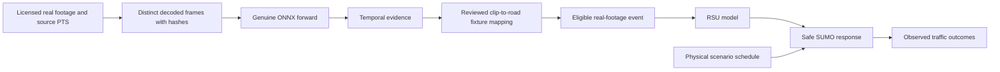

# AI causation, sensing, synchronization, and hardware feasibility

Research date: 2026-10-14. Status: proposed architecture; read-only model/session inspection completed; no simulation, inference forward, implementation, engine installation, model alteration, or cloud resource launch performed during this research.

## Recommendation and decision record

**Proposed decision:** retain SUMO as the traffic and traffic-signal authority, attach an interchangeable 3D renderer, and reuse the existing Python ONNX perception path through an explicit frame/evidence boundary. Support two separate genuine-perception modes: rendered RGB camera frames after a synthetic-domain validation gate, and licensed real footage with a reviewed scenario-location mapping. Provide a third, clearly labeled replay mode for reproducible traffic experiments. Mock communication tests have a separate mode and cannot produce a real-perception badge.

This division permits a visually substantial 50-vehicle city while keeping the number of active inference cameras small. For the network specialist's proposed dense 21-RSU/sparse 13-RSU configurations, begin with two or three sensing units; the remaining stations perform relay, traffic-signal, or recipient-filtering duties. Camera duties and model scheduling must be declared before the hazard seed is drawn. A station's sensor role may be constrained by its field of view; the scheduler cannot select the correct model because it knows the hidden hazard category.

| Architecture option | What it can establish | Main tradeoff | Decision |
|---|---|---|---|
| SUMO + compact local 3D renderer + live rendered RGB + existing CPU models | Closed visual-to-neural-to-warning loop on the target laptop, if pilot gates pass | Synthetic appearance may defeat models; CPU perception is slow | Preferred local research direction; select Three.js or Godot through rendering pilot evidence |
| SUMO + 3D renderer + real footage | Genuine inference and causal traffic response using existing models | Real footage is a mapped sensor fixture rather than observation of the rendered city | Supported fallback and validation mode, prominently labeled |
| SUMO + immutable genuine-inference ledger replay | Repeatable warning timing and paired traffic outcomes | Inference was previously executed; replay is not online sensing | Preferred experiment mode, alongside an online demonstration |
| Remote SUMO + CARLA + inference on one GPU machine, local streamed presentation | Sensor-rich rendered perception and higher visual ceiling | Paid/available hardware, map compatibility, provider support, remote display | Optional later branch after user approval and a pinned-version pilot |
| Local SUMO, remote renderer and inference | Reduced local compute with small pose/event traffic | Network jitter becomes part of capture/delivery lag and failure handling | Feasible hybrid, but less predictable than co-locating coupled engines |

Revisit the local decision if the approved one-junction pilot fails either rendering performance or synthetic perception. A hardware upgrade addresses throughput; it does not establish tree/debris recognition or close the synthetic-domain gap.

## Existing evidence and model scope

Read the existing project memory, approved research/implementation plan/subagent prompt, M1 report, current perception source, final Kaggle training scripts and kernel metadata. The M1 outcome is implementation/smoke acceptance with dataset accuracy and real temporal validation blocked. Older README/project-memory precision, Pi FPS, and standards claims must not be carried into this proposal as verified facts. The appended M1 section supersedes the old inference-defect status, but does not validate old accuracy claims. See [M1 report](../M1_IMPLEMENTATION_REPORT.md).

A fresh read-only inspection created CPU ONNX Runtime sessions and read metadata; it executed **no forward pass**. All three models remain distinct single-class artifacts:

| Specialist | Actual file bytes | Verified SHA-256 | Actual class-0 metadata |
|---|---:|---|---|
| Pothole | 9,940,821 | `289c7d60b8d920ef1da65681629c8fc854ccaf7b01474afc5997ba89b1ca077d` | `pothole` |
| Construction | 9,940,838 | `4144423ff28f6fab297828be7965a8104600359fbd2ed58b0da45e16fa7788f8` | `construction_hazard` |
| Accident/obstacle | 9,940,846 | `dc2985e915d44ff419d205bcae0df9fc1cfdf89960e794730b3afcb2134b96bf` | `road_accident_obstacle` |

All expose one input, `images`, float32 `[1,3,768,768]`, and one output, `output0`, float32 `[1,5,12096]`. Metadata identifies Ultralytics 8.4.175, Detect head, task `detect`, `dynamic=False`, and `end2end=False`. Current read-only sessions used `CPUExecutionProvider`. The current registry validates hashes and contracts; semantic identity must remain `(source_model_id, raw_class_id=0)`. Tensor shape, filenames, and label names establish interface/identity, not competency.

### What the training code actually supports

`kaggle_kernels/accident_detector/train_accident_95plus.py` names CubeAI traffic accidents, car accidents/deformation, road obstacle/debris, and ROD dataset mounts. Its four loaders replace **every accepted source class ID with 0** (lines 55–57, 76–78, 97–99, 118–120), accept images only when boxes exist, shuffle the combined samples with seed 42, and create an image-level 80/10/10 split. There is no explicit tree-category filter, category-specific test report, sequence/source-group split, deduplication stage, or negative-image injection in that inspected script. Dataset names and comments describe intent; mounted dataset contents and actual sample counts are not present as a trusted local training manifest.

`kaggle_kernels/construction_detector/train_construction_95plus.py` filters one dashcam class as barricade, but accepts and remaps every boxed ROD/construction-source class to the same construction label. This creates a **possible semantic overlap** with the accident/obstacle specialist. The overlap is a code-based risk, not a measured cross-model confusion rate. The inspected final script also excludes empty-box source images.

`kaggle_kernels/pothole_detector/train_pothole_95plus.py` implements intended background injection using wildcard `clean-road`, `background`, or `highway` directories (lines 137–145). Whether those mounts existed, were genuinely clean, and supplied the stated number of negative images is unverified. The final pipeline does not establish recognition of every severe fissure or general surface-damage category. All three scripts evaluate PyTorch checkpoints with `augment=True` before dynamic quantization; this is not a held-out INT8 ONNX evaluation at the deployed preprocessing/thresholds.

| Desired scenario | Physical/rendered scenario feasibility | Existing neural evidence | Required perception claim |
|---|---|---|---|
| Pothole | Mesh/decal and explicit road-region ground truth | M1 supplied-image qualitative positive, no formal labels | Fixture recognition only after matched labeled positive/negative tests |
| Severe cracks/general surface damage | Can be rendered | Broad desired domain exceeds audited label evidence | Unverified category until specifically tested |
| Construction signs, cones, barricades | Renderable and lane blockage can be modeled | One sign-like M1 detection; second puddle-like likely false positive | Do not equate a construction-source label with cone/barricade competency |
| Wrecked/collided vehicles | Renderable, safe blockers can represent occupancy | M1 broad box on damaged-vehicle image | Qualitative fixture result; location quality remains uncertain |
| Fallen tree | Render an animated tree and stopped obstacle independently | No verified category-specific training/test evidence | Physical hazard may exist with missed neural detection; never force a warning |
| Road debris | Renderable | Dataset-mount name/comment mentions debris; no inspected labeled category examples | Training intent only; genuine recognition gate remains open |
| Normal vehicle breakdown | Stopped vehicle and lights are renderable | A broad detector cannot reliably infer mechanical failure from appearance | Unverified; ordinary parked/stopped cars are necessary hard negatives |
| Cleared road | Physical obstacle can be removed | No learned clear-road class in any model | Separate visibility-aware observational clearance; absence of detection alone is insufficient |

No original dataset archives were downloaded, and no external dataset publisher's category list was treated as proof of what entered these weights. A future small evidence package should include source licenses, selected samples, original class taxonomy/remap, duplicate/sequence groups, and train/validation/test membership before asserting tree/debris scope. No retraining is required to establish the first fixture test; model improvement would require separate approval.

## Causal flows and source-of-truth boundaries

### Mode A: actual rendered sensor frames

```mermaid
flowchart LR
  Seed[Seeded physical hazard schedule] --> World[Physical obstacle and visual state]
  Sumo[SUMO traffic and signals] --> Snap[Tick snapshot with poses and clock]
  World --> Render[3D scene at snapshot k]
  Snap --> Render
  Render --> RGB[Actual camera RGB and frame hash]
  RGB --> Infer[Registered ONNX model forward]
  Infer --> Track[Validated distinct-frame evidence]
  Track --> Locate[Calibrated or reviewed location estimate]
  Locate --> Event[Confirmed event eligible after service delay]
  Event --> RSU[Modeled dissemination and recipient filtering]
  RSU --> Control[Single TraCI owner requests safe behavior]
  Control --> Sumo
  Sumo --> Observe[Measured speed lane and queue outcomes]
  Seed -. evaluation only .-> Truth[Ground-truth ledger]
  Infer -. match for scoring only .-> Truth
```

The physical scheduler controls when an obstacle appears or disappears and its collision/occupancy representation. SUMO controls all traffic poses and signal phases. The renderer projects a timestamped snapshot into pixels. Perception receives pixels, source/calibration information and frame timestamps, **not hazard presence, category, asset ID, or ground-truth box**. Ground truth is accessible to evaluation and scene construction, not the neural warning decision. Removing a hazard from the image must be allowed to remove the detection even though the schedule still says active.

For SUMO-controlled background traffic, visual actors follow SUMO poses; a renderer's separate vehicle AI/physics controller must not also steer them. A close-up physics ego vehicle, if later required, needs explicit authority transfer and adapter validation. In CARLA co-simulation, select one traffic-light owner and pin actor/coordinate conversion code. The official bridge documents a fixed step and explicit `sumo`/`carla`/`none` light-manager choices. [CARLA–SUMO co-simulation](https://carla.readthedocs.io/en/latest/adv_sumo/).

Capture is technically available in multiple engines: Three.js exposes render-target pixel readback including an asynchronous variant; Godot has camera/subviewport render targets; CARLA supplies RGB images carrying frame/time/transform information. These capabilities establish a route to real synthetic pixels, not current project integration or model recognition. [Three.js renderer API](https://threejs.org/docs/pages/WebGLRenderer.html), [Godot viewports](https://docs.godotengine.org/en/stable/tutorials/rendering/viewports.html), [CARLA sensors, pinned 0.9.16](https://carla.readthedocs.io/en/0.9.16/ref_sensors/).

Keep sensor RGB separate from presentation overlays. Bounding boxes, RSU arcs, hazard badges and ground-truth colored regions are composited only after capture. Validate image orientation, RGB/BGR, dimensions, gamma/tonemapping, exposure, motion blur and readback timestamp. Rendered camera frames must correspond to authoritative tick k; interpolated display poses are presentation conveniences and cannot silently change the sensed world time.

### Mode B: real footage with explicit scenario mapping

Map clip PTS to simulation time with an explicit origin and scale; source PTS is not UTC unless capture provenance supplies UTC. Define an approved mapping reference containing network hash, source camera/station, edge/lane/interval, observation window, expected camera direction, and uncertainty. It grants location to a **detected** event; it must not invent positive prediction. The rendered hazard and real clip are corresponding scenario fixtures, not the same physical sensor observation. Show a permanent `REAL FOOTAGE / SCENARIO MAPPING` label and identify any visual/physical mismatch.

Mode B is a credible first causal demonstration and an independent real-domain validation path. It does not by itself satisfy the user's full virtual-city sensing objective; retain Mode A as an explicit acceptance gate. Test mismatched/negative clips with the same active physical scenario: no neural detection must mean no AI warning. Physical native safety remains active in both baseline and treatment.

### Mode C: genuine-inference replay

Freeze real model/input/raw-output hashes, thresholds, prediction/confirmation evidence and measured service durations into a ledger. Replay chooses event eligibility according to declared timing; it never rebrands stored inference as a current forward. Paired warnings-off/on SUMO experiments consume the same ledger, physical schedule, demand and seed. An online demonstration separately proves that the current workers execute the graphs.

For **vehicle-camera** experiments, warnings alter trajectories and therefore future camera viewpoints. Reusing one recorded ego clip across diverging runs is an open-loop fixture comparison, not closed-loop live sensor equivalence. Static RSU viewpoints simplify paired control experiments, but traffic occlusion can still differ. Record the experimental interpretation; do not assert bit-identical future camera frames under changed traffic.

## Clocks, slow inference, queue policy and reproducibility

Use simulation time from the traffic authority, frame/capture time from the sensor snapshot or clip PTS, UTC for run identification, and monotonic wall duration for processing/transport. Wall timestamps from different machines need a documented clock synchronization/uncertainty method; otherwise measure each machine's durations and use controller receipt time rather than subtracting unrelated monotonic clocks. Python provides monotonic/performance clocks and bounded queues, but their use does not establish cross-machine clock synchronization. [Python time](https://docs.python.org/3.11/library/time.html), [Python queue](https://docs.python.org/3.11/library/queue.html).

Only one coordinator advances SUMO/renderer ticks. In CARLA only one client should tick, and GPU camera frames can arrive a few frames late: match frame IDs instead of attaching each arrival to the latest tick. [CARLA synchrony](https://carla.readthedocs.io/en/latest/adv_synchrony_timestep/). Match the installed SUMO API behavior; subscription values belong to the completed simulation step. [SUMO Python TraCI](https://eclipse.dev/sumo/docs/TraCI/Interfacing_TraCI_from_Python.html).

Proposed timing fields are `capture_sim_s`, `source_pts_s`, `frame_id`, `render_complete_wall`, `enqueue_wall`, `service_start_wall`, `service_finish_wall`, `controller_receive_wall`, `eligible_sim_s`, `sent_sim_s`, `due_sim_s`, `received_sim_s`, `command_sim_s`, and observed response time. Record render/readback, queue, preprocessing, inference, postprocessing, confirmation, network and driver delays separately. Do not count a transport or reaction delay twice.

For serialized ledger scheduling, a service job starts at `max(capture_sim_s, previous_worker_finish_sim_s)` and finishes after its measured full service duration. Confirmation is eligible after the final necessary frame job finishes, and never before capture. Pausing simulation while the worker computes is acceptable for an explicitly paused demonstration, but does not make perception latency zero in an experiment. A real-time run maps actual controller receipt into the running simulation clock and logs missed deadlines.

### The existing tracking gap must be handled explicitly

Current `TemporalHazardTracker` requires ordered distinct frame IDs/times, three processed hits by default, at most a **1.0-second capture gap**, and 2.0-second source-time expiry. A worker using latest frames after seconds-long forwards can receive successive capture times too far apart to confirm. Retrying the same still or pretending repeated frame IDs are new evidence is prohibited. A moving camera also changes pixel boxes through ego motion; the current IoU-only association is not a validated moving-camera tracker.

Recommended first pilot: static sensing cameras capture short three-frame bursts with genuine distinct timestamps and gaps below the declared tracker limit; bounded burst jobs are then processed with all actual delays exposed. Do not label three near-adjacent frames as seconds of persistence. A burst cannot be overwritten mid-processing or mixed with a later burst without validation. If visibility is too brief, queues too old, or no qualifying burst arrives, the correct outcome is unconfirmed/missed detection. Any later change to tracker gap/expiry or ego-motion association needs reviewed temporal data and acceptance criteria.

Use a small global ready-job queue and a per-source latest **complete burst** mailbox, fixed round-robin fairness and deadline rejection. Permit at most a declared number of in-flight bursts. Log superseded/dropped bursts, queue age, worker crashes and deadline expiry; no fabricated result replaces them. Frame sampling, sensor duty cycles and model order are fixed policies independent of scheduled ground truth. Separate the scenario, traffic and communication RNG seeds. Pin network, scene assets, camera calibration, model, runtime, scheduling policy and input hashes. Renderer determinism/driver-dependent pixels must be empirically checked; a reproducible seed alone does not prove identical frames.

### Neural causation acceptance tests

For each warning, require a complete joinable chain: input hash → inference run/raw tensor → source-model prediction → qualifying frame evidence → located event/revision → delivery record → command → observed vehicle response. A call returning successfully is not an observed merge. Record negative predictions as well as positives.

Proposed controls: identical physical hazard with a clean negative input; sensor occlusion; worker disabled/failing; warning dissemination disabled while inference remains enabled; delayed/dropped deliveries; expired burst; duplicate/out-of-order frame; changed model hash; unsupported asset category. There must be no positive AI warning without qualifying prediction. Physical occupancy/local safety reaction is scored separately. Logs should preserve missed detection and late delivery instead of choosing only attractive runs.

## Location and hazard clearance

A 2D box does not establish meters, lane, distance, severity, blockage extent, GPS or mechanical cause. For initial fixed-camera stations, a reviewed road-region mapping can provide an explicit scenario interval with a nullable uncertainty. It must be broad enough to reflect uncertainty and narrow enough to avoid warning the wrong branch. Missing/ambiguous mapping produces a perception-only event; no located traffic command follows.

For calibrated synthetic cameras, keep camera intrinsics/extrinsics and the SUMO-to-renderer transform. A road-plane ray intersection/homography is useful only on its validated surface/height range. The bottom of a wreck/tree bounding box is not guaranteed to be its true road contact, and slopes/occlusion can break flat-plane localization. A depth camera may supply independent sensor range; declare it as a second sensing modality, validate timestamp alignment, and propagate uncertainty. Ground-truth actor IDs or scenario coordinates may score localization but cannot silently substitute for estimated hazard position. For vehicle sensing, combine timestamp-matched ego pose and camera calibration; source identity changes with the vehicle, not merely the nearest RSU.

Proposed localization gate: check surveyed scene landmarks, camera-ground projection, handedness/yaw/offset/units, lane association and off-road rejection against a reviewed tolerance tied to lane width. The tolerance must be approved before evaluating hazard fixtures. A broad M1 accident box needs specific localization testing before guiding a lane maneuver.

None of the current heads learns a `road_clear` label. Detection disappearance can mean occlusion, lighting change, model miss, camera departure or drop. Retain separate physical clear time and observed clearance evidence. A proposed observation policy requires fresh healthy frames, the previously observed region in view, no occlusion, and repeated negative evidence after validation on clean/occluded clips. Until that gate passes, clearance is manual/reviewed experiment input with its own label. TTL means knowledge expired; it does not prove the obstacle disappeared. Native safety and ongoing vehicle protection must survive stale warnings.

## Hardware and deployment feasibility

The parent audit `HOST_PROJECT_AUDIT.json` records Ryzen 5 5500U, six physical/twelve logical CPU cores, 7.38 GiB usable physical RAM and about **1.30 GiB available at the audit** (82.4% used). Registry GPU evidence identifies integrated AMD Radeon graphics with 512 MiB reported dedicated memory; shared memory/API/driver support is not a measured graphics benchmark. Disk free is 159,288,545,280 bytes (about 148.35 GiB). The platform string includes build 26300 but is not Windows edition proof. ONNX Runtime 1.31.0 exposes Azure and CPU providers; the inspected models run through CPU sessions. Executables not found on PATH are not proof an engine is absent elsewhere.

M1 historical inference-only desktop observations were 2.238439 s pothole, 2.030734 s construction, and 2.011490 s accident/obstacle. Their sum is **6.280663 s per serial triplet** (arithmetic, not a new concurrent benchmark), roughly 0.159 triplets/s before other stages. Processing three-frame bursts through all three models would consume about 18.84 s of inference work for one camera under those observations; two or three cameras give about 37.68/56.53 s per full cycle before overhead/contention. These estimates explain why 50 moving vehicle actors must not imply 50 live perception cameras.

At 40 km/h, 6.28 s corresponds to about 69.8 m of vehicle travel and 18.84 s to about 209 m. These are illustrative kinematics, not measured warning lead distances or safety claims. Render, queue, transport, confirmation and driver delays add to the budget. A sparse sensing network cannot promise a warning about a tree that falls after the only camera vehicle has passed; a stationary camera with visibility, a later mobile observer, or an admitted missed-detection outcome is necessary.

| Option | Published requirements/evidence | Project implication and first gate |
|---|---|---|
| Local Godot compatibility renderer | Native simple-project editor minimum 4 GB RAM and OpenGL 3.3 integrated graphics; 8 GB editor RAM recommended. These are simple-project baselines. [Godot requirements](https://docs.godotengine.org/en/stable/about/system_requirements.html) | Plausible compact city runtime, no guaranteed FPS. Use exported runtime and one sensor render target; monitor total RSS/frame times before scaling |
| Local Three.js/WebGL2 | Actual render targets and pixel readback are documented, including async readback. [Three.js API](https://threejs.org/docs/pages/WebGLRenderer.html) | Lightweight deployment path if current driver/browser supports it. Browser plus Python memory still competes; 50 instanced vehicles, conservative materials/LOD and one capture viewport must be profiled |
| Local Unity 6 | Editor minimum recommended RAM is 8 GB; Windows graphics support requires suitable supported drivers/APIs. [Unity 6.0 requirements](https://docs.unity3d.com/6000.0/Documentation/Manual/system-requirements.html) | Available RAM is already below combined editor/SUMO/ORT needs. A small exported build may be feasible; editor feasibility is not runtime performance evidence |
| Unreal editor | Published recommended hardware includes 32 GB RAM and 8 GB graphics memory. [Epic specifications](https://dev.epicgames.com/documentation/en-us/unreal-engine/hardware-and-software-specifications-for-unreal-engine) | Current laptop is a poor development target; remote workstation or scoped exported runtime would need new evidence |
| CARLA 0.9.16 / UE4 | Pinned quickstart recommends dedicated 2070-equivalent or better with at least 8 GB VRAM. [0.9.16 quickstart](https://carla.readthedocs.io/en/0.9.16/start_quickstart/) | Does not match integrated laptop. Remote GPU candidate with mature bridge; compatibility must be verified |
| CARLA UE5 | UE5 quickstart recommends RTX 3000-series or better with 16 GB VRAM, 130 GB storage, Ubuntu 22.04 or Windows 11. [UE5 quickstart](https://carla-ue5.readthedocs.io/en/latest/start_quickstart/) | High-cost footprint relative to current machine. Choose exact tagged package before custom-map design |

**CARLA version caveat:** the inspected official download/release listing calls 0.9.16 latest for the ordinary UE4 track. UE5 0.10.0 is a separate branch; its release announcement lists unsupported large maps/OpenDRIVE import/asset import and reports internal 24/25 FPS observations without a transferable PFPD benchmark. Later `ue5-dev` capabilities may differ. Pin the tested package/server/API/bridge rather than conflating documents or selecting UE5 from appearance alone. [0.9.16 download page](https://carla.readthedocs.io/en/0.9.16/download/), [0.10.0 release](https://carla.org/2024/12/19/release-0.10.0/).

### Provider optimization without changing weights

Tune thread counts and duty cycles only through measured tests. Current CPU sessions are the verified baseline. Running three four-thread sessions concurrently can oversubscribe the CPU and compete with renderer/SUMO memory; speedup is unverified. Static 768 input cannot simply be fed 320/640 tensors for speed. Crop/resize/tiling choices change visual coverage and predictions and require their own tests.

DirectML can target Windows GPU hardware, but is now in sustained engineering; Microsoft directs new development toward WinML. DirectML sessions require sequential execution, disabled memory pattern optimization and no simultaneous `Run` calls on one session. AMD hardware presence does not prove these graphs are accelerated, fully supported, or faster. [ORT DirectML](https://onnxruntime.ai/docs/execution-providers/DirectML-ExecutionProvider.html). Current installed providers do not include DirectML or CUDA; an optimization trial would use a separately approved environment and immutable weights.

For a remote NVIDIA machine, pin CUDA/cuDNN and ONNX Runtime compatibility and inspect actual provider/node placement plus CPU fallback and complete latency. [ORT CUDA](https://onnxruntime.ai/docs/execution-providers/CUDA-ExecutionProvider.html). Existing INT8 filenames do not establish all layers execute INT8 on a GPU. ORT generally recommends static quantization for CNNs and dynamic for transformers/RNNs; that guidance explains an investigation path, not permission to alter these weights or promise acceleration. [ORT quantization](https://onnxruntime.ai/docs/performance/model-optimizations/quantization.html).

### Network and cloud budget

Illustrative raw data arithmetic: a 768×768 RGB uint8 frame is 1,769,472 bytes (1.6875 MiB), or 14.16 Mbit; two such frames/s are about 28.31 Mbit/s per camera before framing. A float32 model input is 6.75 MiB. Avoid shipping float tensors or all 21 virtual RSU feeds. Fifty vehicle snapshots at 10 Hz with an assumed 200-byte record are about 0.8 Mbit/s before protocol/JSON overhead; this assumption must be checked against the actual serializer. JPEG/video compression saves bandwidth but changes evidence/input pixels, so archive exactly what the model consumed and measure its effect.

Prefer co-locating renderer, inference and SUMO on a remote GPU for tight experiments; send presentation video and compact telemetry to the laptop. For a local SUMO/remote-renderer hybrid, buffer timestamped snapshots, render acknowledged frames, return event evidence with capture time, and record uplink/readback/inference/downlink delay. Reject late messages; reconnect cannot reintroduce expired events. GPU inference alone is easier to offload than full interactive rendering, but it leaves local rendering constrained. Cloud compute GPU access does not automatically include working Vulkan/OpenGL/EGL, desktop streaming, graphics licensing or model operator coverage.

The public Runpod pricing page, marked updated October 8, 2026, displayed A5000 24 GB at $0.27/h, L4 24 GB at $0.59/h, and RTX 4090 24 GB at $0.89/h. For an illustrative 10 GPU-hour pilot these correspond to $2.70/$5.90/$8.90 compute; 40 hours are $10.80/$23.60/$35.60. It also lists standard network storage below 1 TB at $0.07/GB/month, so an illustrative 150 GB retained volume is $10.50/month. The extracted page shows Secure/Community controls without an unambiguous selected tier; these are displayed rates, not an account quote or availability guarantee. Final GPU/tier/region, persistent storage, taxes and other charges must be quoted before approval. [Runpod pricing](https://www.runpod.io/pricing).

DigitalOcean's Paperspace table lists RTX4000 $0.56/h and A4000 $0.76/h with plan restrictions; these are distinct cards and should not be conflated. A4000 10/40 compute hours are $7.60/$30.40 before subscription/storage/networking. Its 250 GB block-storage maximum is $10/month, and user Pro plan maximum is $8/month. [Paperspace pricing](https://docs.digitalocean.com/products/paperspace/pricing/). Google lists T4 GPU component $0.35/h; that excludes the host VM/storage and is not a comparable all-in remote desktop quote. [Google GPU pricing](https://cloud.google.com/products/compute/gpus-pricing?hl=en).

Free notebook allocations may help offline model evidence but cannot be assumed to provide long-lived interactive 3D display, fixed hardware, persistent ports, or guaranteed quotas. No free/paid cloud account, credits, region capacity, or driver stack was accessed here. No cloud service was started. The 130 GB UE5 storage guidance also means a 150 GB example volume leaves little development/log headroom; select a larger quoted volume if that branch is approved. Stopped storage can continue billing, and stopping/restarting does not guarantee the same GPU becomes available. [Runpod storage explanation](https://www.runpod.io/blog/where-did-my-files-go-a-straight-guide-to-runpod-storage), [Runpod restart availability](https://docs.runpod.io/pods/troubleshooting/zero-gpus).

## Approval-gated pilot and acceptance sequence

1. **Perception fixtures:** obtain small licensed labeled positives and clean/ambiguous/occluded negatives for each supported real category. Freeze the existing thresholds; measure outputs honestly. Fallen tree/debris are their own gates, never substituted by wreck recognition.
2. **Synthetic single-station pilot:** author one road/junction segment, a fixed camera and a few representative assets, with scene-camera calibration. Capture actual raw frames and run existing models; record misses and false positives across agreed appearance/lighting/distance variants. Ground truth must stay outside perception. Synthetic asset success must not be inferred from a matching name or texture.
3. **Rendering/resource pilot:** add 50 SUMO-controlled actors and functional signal visuals at a stated viewport resolution. Proposed display target is 30 FPS, with a provisional minimum 20 FPS/p95 frame time ≤50 ms and sustained simulation real-time factor ≥0.9 for a declared session. These are proposed pass criteria, not measured capability. Collect RSS, page faults, queue ages and actual forward timing concurrently; review RAM headroom before any engine/editor trial.
4. **First neural causal scenario:** genuinely captured three-frame burst → delayed confirmation → reviewed location → modeled RSU delivery → safe command → measured response. Show physical ground truth, sensor image, neural state and warning state separately. Include no-detection and delayed-failure controls.
5. **Second station and replay:** verify bounded scheduling/fairness, duplicated/expired event handling, burst deadlines and clock alignment. Freeze a genuine ledger for paired traffic comparisons, then compare replay timing with an online run. Moving-camera work follows separate ego-motion validation.
6. **City scale and optional cloud:** scale scene/network only after the above gates. Verify sustained 50 active actors and declared two/three-camera coverage gaps; benchmark both relay deployment configurations. Approve a capped GPU-hour cloud trial only if local rendering/inference needs it. Remote engines/providers and geometry bridge remain version-pinned experiments.

Assets currently blocking full perception acceptance: trusted category labels/negative set, timestamped clips, fallen-tree/debris samples with provenance, validated synthetic hazard visuals, calibrated camera-to-road transforms, and physical Pi/radio measurements. FPS, synthetic detection quality, real-time concurrent latency, acceleration gains, cloud streaming quality and safety benefit remain unmeasured. This research does not authorize any of the pilots or later implementation; it supplies their reviewable scope and evidence gates.
